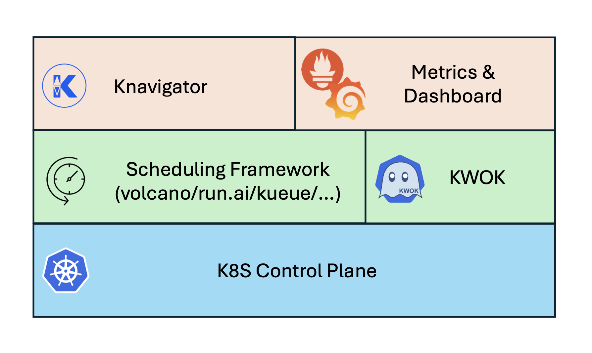

<p align="center"><a href="https://github.com/NVIDIA/knavigator" target="_blank"></a></p>

# Knavigator


## Overview

Knavigator is a project designed to analyze, optimize, and compare scheduling systems, with a focus on AI/ML workloads. It addresses various needs, including testing, troubleshooting, benchmarking, chaos engineering, performance analysis, and optimization. 

The term "knavigator" is derived from "navigator," with a silent "k" prefix representing "kubernetes." Much like a navigator, this initiative assists in charting a secure route and steering clear of obstacles within the cluster.

Knavigator interfaces with Kubernetes clusters to manage tasks such as manipulating with Kubernetes objects, evaluating PromQL queries, as well as executing specific operations.

Knavigator can operate both outside and inside a Kubernetes cluster, leveraging the Kubernetes API for task management.

To facilitate large-scale experiments without the overhead of running actual user workloads, Knavigator utilizes [KWOK](https://kwok.sigs.k8s.io/) for creating virtual nodes in extensive clusters.

## Architecture



### Components

- **K8S control plane**: a set of components that manage the state and configuration of a vanilla Kubernetes cluster.
- **Scheduling Framework**: cloud-native job scheduling system for batch, HPC, AI/ML, and similar applications in a Kubernetes cluster.
- **KWOK**: Allows for the rapid setup of simulated Kubernetes clusters with minimal resource usage.
- **Knavigator**: Facilitates communication with the Kubernetes cluster via the Kubernetes API, enabling task management and data retrieval.
- **Metrics & Dashboard**: Gathers and processes metrics from the cluster, focusing on scheduling performance and resource utilization.

### Workflow

Knavigator runs as a command that executes workflow files, as an HTTP server that accepts workflows, or as Go packages inside other programs. `knavigator -port <port>` starts the server: it takes a workflow in YAML as the body of a `POST /workflow` request, runs its tasks, and replies `200 OK` when they all succeed, or with an error status and message when one fails. `klient -address <url> -workflow <files>` sends workflow files to a running server.

In its standalone mode, Knavigator can be set up using a descriptive YAML file, where users specify the sequence of tasks to be executed. This mode is ideal for isolated testing scenarios where Knavigator operates independently.

Alternatively, in server or package configurations, Knavigator can receive a series of API calls to define the tasks to be performed. This mode facilitates integration with existing systems or frameworks, providing flexibility in how tasks are defined and managed.

Regardless of the configuration mode, Knavigator executes tasks sequentially. Each task is dependent on the successful completion of the preceding one. Therefore, if any task fails during execution, the entire test is marked as failed. This ensures comprehensive testing and accurate reporting of results, maintaining the integrity of the testing process.

### Documentation

- [Deployment](docs/deployment.md)
- [Getting started](docs/getting_started.md)
- [Task management](docs/task_management.md)
- [Metrics and Dashboards](docs/metrics.md)
- [Benchmarking](resources/benchmarks/README.md)
- [Changelog](CHANGELOG.md)

## Install

Knavigator builds from source with Go, at the version `go.mod` names. In a clone of this repository, run:

```shell
make build
```

This builds `knavigator`, `klient` and `node-resource-exporter` into `bin/`. `make image-build` also builds a container image that holds those binaries and the workflows under `resources/`.

Two Helm charts under [`charts/`](charts) install the parts that run in the cluster: `virtual-nodes` creates KWOK virtual nodes, and `node-resource-exporter` deploys the exporter that publishes each node's resource requests, limits and occupancy as Prometheus metrics.

[Deployment](docs/deployment.md) covers Prometheus, KWOK, the virtual nodes, and running Knavigator outside or inside the cluster. [Getting started](docs/getting_started.md) links the workflows tested with each scheduler.

## Support

- Bugs, feature requests and questions: [open an issue](https://github.com/NVIDIA/knavigator/issues).
- Security vulnerabilities: do not open an issue; report them as [SECURITY.md](SECURITY.md) describes.
- Contributions: see [CONTRIBUTING.md](CONTRIBUTING.md).
