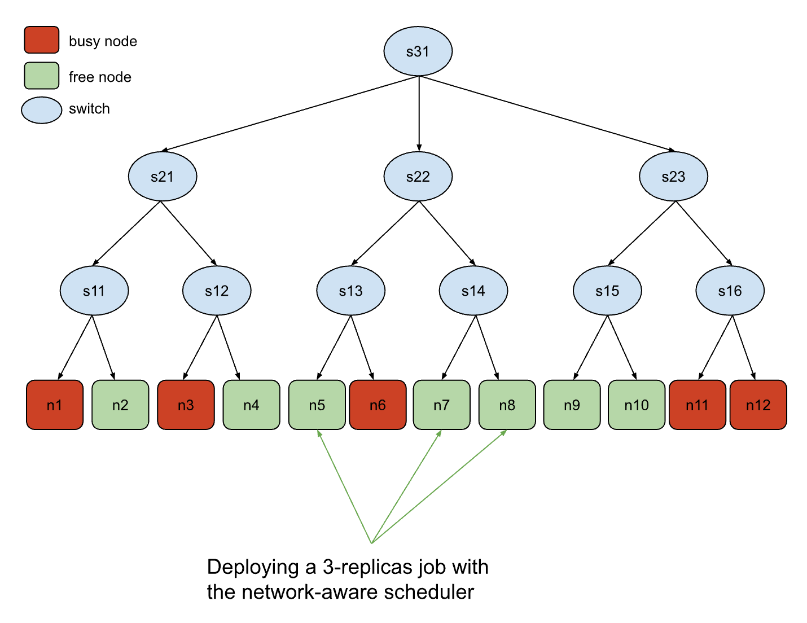

# Benchmark Tests

This directory contains benchmark tests for the following workload managers and schedulers:

- Kueue
- Volcano
- Yunikorn
- Kai
- Run:ai

The benchmark tests involve submitting workloads intended to evaluate the scheduler's performance under specific scenarios.

These workloads are designed to fully utilize the cluster under optimal scheduling conditions.

One approach to benchmarking is to run this workload on clusters with different schedulers and then compare the average GPU occupancy of the nodes.

For all workload managers except Run:ai, the benchmark test involves two sequential workflows. The first workflow registers the CRDs, and the second workflow runs the common part of the test.
Run:ai requires additional customization and thus has a separate workflow

## Gang Scheduling Benchmark Test

The gang-scheduling benchmark workflow operates on 32 virtual GPU nodes, submitting a burst of 53 jobs with replica numbers ranging from 1 to 32 in a [predetermined order](gang-scheduling/workflows/run-test.yaml).

#### Example

To run the benchmark test for Kueue:

```bash
./scripts/benchmarks/gang-scheduling/run-kueue.sh
```

To run the benchmark test for Run:ai

```bash
./scripts/benchmarks/gang-scheduling/run-runai.sh
```

## Fill the Cluster Benchmark Test

The fill-cluster benchmark creates one single-GPU job for every GPU on 256 virtual nodes of 8 GPUs, 2048 jobs, and checks that every pod reaches Running. It follows KAI's "Sanity Fill Cluster" scale test (`test/e2e/scale/kwok_test.go:327-352` and `kwok_test_functions.go:89-138` in KAI v0.19.0) and has the same two cases:

- `running`: the scheduler runs while the jobs are created ([`run-submit.yaml`](fill-cluster/workflows/run-submit.yaml), then [`run-check.yaml`](fill-cluster/workflows/run-check.yaml)).
- `paused`: the scheduler is stopped before the jobs are created. Once every pod or job exists, the run holds for 30 seconds, checks once that nothing was placed, starts the scheduler again and checks that every pod reaches Running.

The run checks that every job got placed: every pod reaches Running. It does not check that all the pods ran at the same time. Each pod runs for 6 minutes (`ttl` in `run-submit.yaml`), so only a run whose `placement_span_sec` is under 360 seconds can have had every pod running at once; read it from `results.json`.

The virtual nodes carry the taint `kwok.x-k8s.io/node=fake:NoSchedule`, and the fill jobs tolerate it, so it keeps every pod without the toleration off the virtual nodes. A pod that tolerates every taint can still land there. This matters for KAI: the operator creates the scheduler pod again on resume, and on a virtual node KWOK would fake it as Running with no scheduler process behind it.

| Scheduler | How the run stops it | Expected while stopped | Expected after it resumes | Source |
|---|---|---|---|---|
| KAI | `kai-config` `spec.scheduler.service.enabled: false`, and `true` to resume ([`pause-kai.yaml`](fill-cluster/workflows/pause-kai.yaml), [`resume-kai.yaml`](fill-cluster/workflows/resume-kai.yaml)) | every pod Pending | every pod Running | KAI v0.19.0 `kwok_test_functions.go:89-138`, which toggles the same field (`test/e2e/modules/configurations/scheduler.go`) |
| Kueue | ClusterQueue `fill` `spec.stopPolicy: Hold`, and `None` to resume ([`pause-kueue.yaml`](fill-cluster/workflows/pause-kueue.yaml), [`resume-kueue.yaml`](fill-cluster/workflows/resume-kueue.yaml)) | every Job still `suspend: true` | every pod Running | Kueue v0.20.2 `apis/kueue/v1beta2/clusterqueue_types.go`: a ClusterQueue whose `stopPolicy` is not `None` makes no new reservation |

With `-results`, `placement_span_sec` is how fast the scheduler placed the jobs, and `last_placement_sec` is the time from the start of the run (the first pod created or job submitted) to the last pod placed (see [metrics](../../docs/metrics.md)). The two schedulers resume differently. KAI's operator deletes the scheduler Deployment when it is disabled and creates it again on resume, so a paused KAI run includes a scheduler restart, while Kueue's controller keeps running and only starts admitting. KAI's own test times from the resume patch, restart included; `placement_span_sec` starts at the first placement after the restart, so it leaves the restart out, and `last_placement_sec` keeps it in. Compare a scheduler's paused and running cases with that in mind.

The run files are not specific to a scheduler: a `config-<scheduler>.yaml` that registers a single-GPU job as `register` can reuse them. The job template sets its own queue and tolerates the virtual nodes' taint; `run-submit.yaml` passes only `replicas`, `gpu` and `ttl`. Preemption, including KAI's preemption delay, is not part of this benchmark, and the slurm-bridge templates and configuration live with slurm-bridge, not in this repository.

The paused KAI case was tested with KAI v0.19.0. `scripts/schedulers/kai.sh` installs v0.18.6 unless `KAI_VERSION` says otherwise:

```bash
KAI_VERSION=v0.19.0 ./scripts/schedulers/kai.sh
```

#### Example

The run scripts take the case and a results directory, and pass extra flags through to Knavigator. `NODE_ADDRESS`, when set, becomes the virtual nodes' InternalIP. The scripts run Knavigator from the repository root, because the workflows name their templates relative to it. A relative results directory is resolved from your directory first, but any other relative path, in a pass-through flag such as `-kubeconfig ./kc` or in `KUBECONFIG`, resolves from the repository root; use absolute paths there.

```bash
./scripts/benchmarks/fill-cluster/run-kai.sh paused ./results-kai-paused
./scripts/benchmarks/fill-cluster/run-kueue.sh running ./results-kueue-running
```

`-var jobs=<n>` submits fewer jobs. The paused checks take their expected value from `-var paused_status=<phase>` (KAI, default `Pending`) and `-var paused_suspend=<bool>` (Kueue, default `true`), so a run with a wrong value can show that the check fails.

A paused run that fails before it resumes the scheduler, such as a run with a wrong expected value, leaves the scheduler stopped for every later run on the cluster. Restart it with the command for the scheduler.

KAI:

```bash
kubectl patch configs.kai.scheduler kai-config --type merge -p '{"spec":{"scheduler":{"service":{"enabled":true}}}}'
```

Kueue:

```bash
kubectl patch clusterqueues.kueue.x-k8s.io fill --type merge -p '{"spec":{"stopPolicy":"None"}}'
```

## Priority Preemption Matrix Benchmark Test

The preemption-matrix benchmark runs pairs of single-GPU jobs on 256 virtual nodes of 8 GPUs and checks, per pair, whether the second job preempted the first. The pairs are the eight cases of KAI's preempt test (`test/e2e/suites/preempt/preempt_specs.go` in KAI v0.19.0). Each pair has its own queue whose quota admits exactly one 1-GPU job, with no cohort and no borrowing, so a pair's second job runs only if it preempts the first, and no pair can take another pair's GPU. Every pair runs at once:

1. [`config-priorities.yaml`](preemption-matrix/workflows/config-priorities.yaml) creates four PriorityClasses before any job exists. KAI gives a pod whose PriorityClass is missing its default class instead.
2. `run-first-*.yaml` submits every pair's first job and waits until each is Running.
3. `run-second-*.yaml` submits every pair's second job.
4. [`run-hold.yaml`](preemption-matrix/workflows/run-hold.yaml) waits 60 seconds, then the `check-*.yaml` files look at each pair once, in pair order. Knavigator stops at the first check that fails, so a red run names one pair that differs from the table and says nothing about the pairs after it.

A pair is (first job, second job), not (low, high): pairs 4 to 6 start the higher-priority job first, and pairs 7 and 8 use two jobs of the same class. The first job runs for 5 minutes and the second for 3, both counted from when the pod starts. At the check the second job has about 2 minutes left, so a pair that preempted still shows the second job Running and not the first one back. The first job has about 4 minutes left, so a pair that did not preempt still shows the first job Running and not the second one in its place.

| Class | Value | KAI |
|---|---|---|
| `pm-low-p` | 40 | preemptible |
| `pm-high-p` | 41 | preemptible |
| `pm-low-np` | 140 | non-preemptible |
| `pm-high-np` | 141 | non-preemptible |

KAI treats a priority below 100 as preemptible and one of 100 or more as non-preemptible: its PodGroup CRD says "When unspecified, preemptibility is determined by the PriorityClass value - values below 100 are considered preemptible" (`deployments/kai-scheduler/crds/scheduling.run.ai_podgroups.yaml:74`), and its tests use the same `NonPreemptiblePriorityThreshold` (`test/e2e/modules/constant/constant.go:14`). Its test picks random values with the same relations, high = low + 1 (`preempt_specs.go:51-73`). The jobs carry no `kai.scheduler/preemptibility` label, which would override the threshold.

| Pair | First -> second | KAI | KAI source (`preempt_specs.go`) | Kueue | Kueue source |
|---|---|---|---|---|---|
| 1 | `pm-low-p` -> `pm-high-p` | preempts | `It` :88, `ForPodScheduled(highPod)` :107 | preempts | `pkg/scheduler/preemption/policy/preemption_policy.go:31-33`: 41 > 40 |
| 2 | `pm-low-p` -> `pm-high-np` | preempts | :110, `ForPodScheduled(highPod)` :129 | not applicable | |
| 3 | `pm-low-np` -> `pm-high-np` | does not | :132, `ForPodUnschedulable(highPod)` :151 | not applicable | |
| 4 | `pm-high-p` -> `pm-low-p` | does not | :154, `ForPodUnschedulable(lowPod)` :173 | does not | `preemption_policy.go:31-33`: 40 > 41 is false |
| 5 | `pm-high-np` -> `pm-low-np` | does not | :176, `ForPodUnschedulable(lowPod)` :195 | not applicable | |
| 6 | `pm-high-np` -> `pm-low-p` | does not | :198, `ForPodUnschedulable(lowPod)` :217 | not applicable | |
| 7 | `pm-low-p` -> `pm-low-p` | does not | :220, `ForPodUnschedulable(pod2)` :239 | does not | `preemption_policy.go:31`: strictly greater, 40 > 40 is false |
| 8 | `pm-low-np` -> `pm-low-np` | does not | :242, `ForPodUnschedulable(pod2)` :261 | not applicable | |

Kueue line numbers are Kueue v0.20.2. Kueue runs pairs 1, 4 and 7 only, the pairs where both jobs are preemptible. Kueue has no per-job preemptibility: `withinClusterQueue: LowerPriority` lets a job preempt any job of strictly lower priority in its ClusterQueue (`preemption_policy.go:27-33`). The pairs with a non-preemptible job test something Kueue cannot express as it installs. Kueue has an alpha `PreemptionConfig` API (`apis/kueue/v1alpha1/preemptionconfig_types.go`) whose rules can select victims by workload label, but this benchmark does not use it: its feature gate `ConfigurablePreemptions` is off by default (`pkg/features/kube_features.go:1325-1326`), and its CRD is not in the release `manifests.yaml` that `scripts/schedulers/kueue.sh` applies.

KAI's test runs CPU pods in a queue with a CPU quota and limit of 500m (`preempt_specs.go:44-48`). This benchmark asks for GPUs instead: each pair's queue has a GPU quota and limit of 1, and each job asks for 1 GPU. For KAI the pair queues are children of a parent queue with no GPU quota or limit, because KAI checks quota and limit on every ancestor; CPU and memory stay unlimited. For Kueue each pair has a ClusterQueue with a nominal quota of 1 GPU and CPU and memory to spare.

The checks name the object they read, because a scheduler may never create the pod a check would look for:

- Both schedulers ([`check-p.yaml`](preemption-matrix/workflows/check-p.yaml), [`check-np.yaml`](preemption-matrix/workflows/check-np.yaml)): in a pair that preempts, the second job's pod is Running; in a pair that does not, the first job's pod is Running.
- KAI ([`check-kai.yaml`](preemption-matrix/workflows/check-kai.yaml)): in a pair that preempts, the first job's pod is Pending. KAI preempts by deleting the pod (`pkg/scheduler/cache/evictor/default_evictor.go:41`), and the Job controller creates a replacement, which waits in the full queue. In a pair that does not, the second job's pod is Pending.
- Kueue ([`check-kueue.yaml`](preemption-matrix/workflows/check-kueue.yaml)): the first Job of pair 1 and the second Jobs of pairs 4 and 7 have `spec.suspend: true`. Kueue preempts by suspending the Job (`pkg/controller/jobs/job/job_controller.go:170-172`), and creates no pod for a Job it has not admitted.

Every job finishes: a preempted first job runs again once the second is done, and a second job that waited runs once the first is done. With `-results`, a victim's deleted pod counts as evicted (`pods_evicted`), not failed. A KAI run records 18 GPU pods, the 16 jobs plus a replacement pod for each of the two victims; a Kueue run records 7, the 6 jobs plus the pod created when pair 1's first job is admitted again.

#### Example

The run scripts take the case, `matrix`, and a results directory, and pass extra flags through to Knavigator, as the fill-cluster scripts do. Each run needs a fresh cluster with one scheduler: the jobs keep their names after a run, so a second run on the same cluster fails to create them. KAI must be v0.19.0:

```bash
KAI_VERSION=v0.19.0 ./scripts/schedulers/kai.sh
./scripts/benchmarks/preemption-matrix/run-kai.sh matrix ./results-kai-matrix
```

On another fresh cluster, with Kueue:

```bash
./scripts/schedulers/kueue.sh
./scripts/benchmarks/preemption-matrix/run-kueue.sh matrix ./results-kueue-matrix
```

Each check takes its expected value from a `-var`, so a run with a wrong value can show that the check fails: `pair<N>_first_status` and `pair<N>_second_status` for a pod phase, `pair<N>_first_suspend` and `pair<N>_second_suspend` for a Kueue Job, each defaulting to the value in the table. `-var priority_low_p=<n>`, and likewise `priority_high_p`, `priority_low_np` and `priority_high_np`, set a class's value, and `-var within_cluster_queue=Never` turns off Kueue's preemption. A PriorityClass value cannot change once created, so run each on a fresh cluster.

## Mixed Trace Benchmark Test

The mixed trace benchmarks replay a day of inference and training on 64 virtual GPU nodes with a [`SubmitTrace`](../../docs/task_management.md#submittrace) task. The classes compete for the same GPUs, so a run shows how a scheduler trades inference latency against gang progress. With `-results`, `wait_by_class` reports each class's wait separately.

- [`mixed`](mixed/workflows/run-mixed.yaml) is a steady trickle. Inference is 600 short, high-priority, single-GPU jobs. Training is 200 long, low-priority jobs on 2 to 8 GPUs, about a quarter of them gangs of up to 48 nodes, all arriving at random.
- [`burst`](mixed/workflows/run-burst.yaml) adds bursts on top of a steady trickle. Inference and part of the training arrive evenly over the day, 40 training jobs land at once at hours 0 and 12, and gangs of 48 and all 64 nodes arrive at fixed hours. Gang sizes do not divide the fleet evenly, and a 64-node gang can only start once every node is free.

The run scripts replay a trace at 60 times speed and pass extra flags through to Knavigator. `TRACE=burst` selects the burst trace. Volcano and Kueue are supported.

#### Example

```bash
./scripts/benchmarks/mixed/run-volcano.sh -results ./results-volcano
TRACE=burst ./scripts/benchmarks/mixed/run-volcano.sh -results ./results-volcano-burst
```

## Scaling Benchmark Test

The scaling benchmark workflow operates on 700 virtual GPU nodes with tho workflows. The first [workflow](scaling/workflows/run-test-multi.yaml) submits is a job with 700 replicas, the second [workflow](scaling/workflows/run-test-single.yaml) submits a batch of 700 single-node jobs.

### Example

To run the benchmark test for Volcano:

```bash
./bin/knavigator -workflow 'resources/benchmarks/scaling/workflows/{config-nodes.yaml,config-volcano.yaml,run-test-multi.yaml}'
```

To run the benchmark test for Run:ai

```bash
./bin/knavigator -workflow 'resources/benchmarks/scaling/workflows/{config-nodes.yaml,config-runai.yaml,runai-test-single.yaml}'
```

## Network Topology Benchmark Test

The network topology benchmark workflow runs on 12 virtual GPU nodes, arranged to simulate a tree-like network topology.
Out of these, 5 nodes are marked as busy, leaving 7 nodes available. The workflow submits a job with 3 replicas.

From a network connectivity standpoint, the optimal assignment would be nodes n5, n7, and n8, as shown in the following diagram.



### Example

To run the benchmark test for Run:ai

```bash
./bin/knavigator -workflow 'resources/benchmarks/nwtopo/workflows/{config-nodes.yaml,runai-test.yaml}'
```
